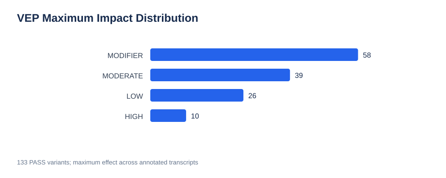
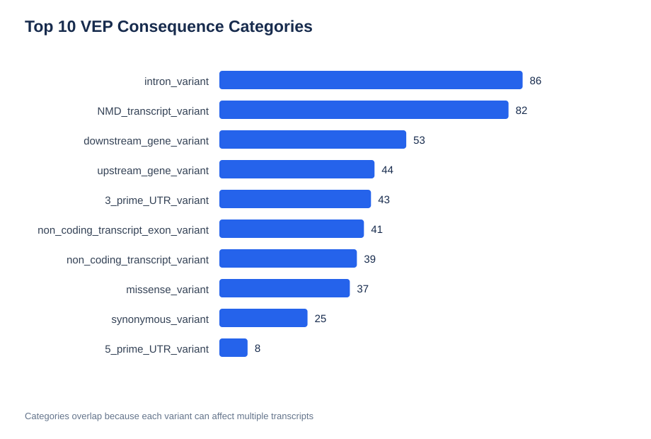
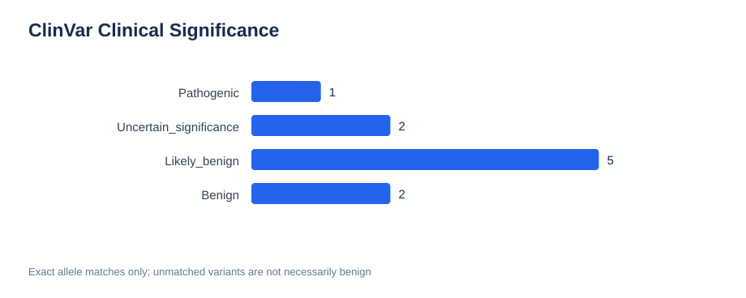
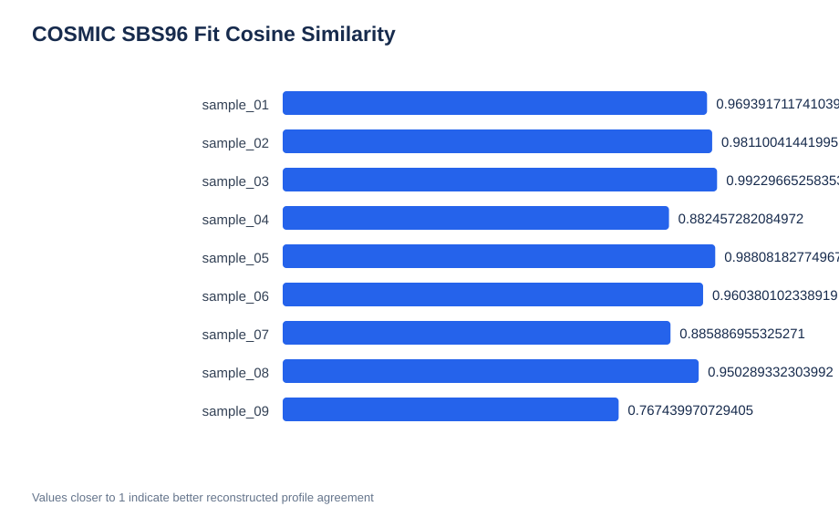

# Cancer Genomics Practicals — Autumn Semester 2026

**University of Bern | UBELIX HPC**

## Team members

1. Ana Wolf Ruiz

2. Gülce Berfin Ercan

3. Tushar Singh

## Project scope

This repository contains SLURM submission scripts, supporting Python/R programs, and analysis notes for the Cancer Genomics practicals. It covers (1) sequencing QC and somatic variant calling/annotation, and (2) COSMIC SBS96 mutational signature analysis and simulations. The numbered `submissions/` scripts group the work for delivery; their numeric order is a **submission organization**, not an assertion that every step was run in that order or that all scripts were executed.

The project was performed on the University of Bern UBELIX cluster. Absolute paths and module versions are specific to that environment. Course datasets, large reference files, environment directories, and generated results are intentionally excluded from the source-code repository and ZIP.

## 1. Somatic variant calling and annotation

### Input and methods

- Paired tumor/normal FASTQ files provided in `/data/courses/cancergenomics/VAR_CALLING/fastq/`.

- Prepared reference and resources under `/data/courses/cancergenomics/VAR_CALLING/`.

- Downstream somatic calling used the **course-provided** recalibrated tumor/normal BAM files under `/data/courses/cancergenomics/VAR_CALLING/alignments/`.

- FastQC, fastp, and MultiQC for read QC; GATK Mutect2 and FilterMutectCalls for somatic variant discovery/filtering; Ensembl VEP 116.3 for functional annotation; exact-allele ClinVar GRCh38 VCF matching and an exploratory variant-prioritization script.

- The course reference used in the somatic variant-calling practical contains chromosomes 6 and 17; the ClinVar resource is GRCh38 with unprefixed chromosome names (e.g. `6` versus `chr6`). ClinVar matches were made using CHROM, POS, REF and ALT, after normalizing the chromosome prefix.

### Variant results

| Metric | Value |
| --- | ---: |
| Calls after Mutect2 filtering (all filter statuses) | 467 |
| PASS variants | **133** |
| PASS variants annotated by VEP | **133** |
| Exact ClinVar allele matches | **10** |
| Without a ClinVar match | 123 |
| Variants with HIGH or MODERATE effect on at least one annotated transcript | **49** |

Maximum VEP impact across annotated transcripts: **HIGH 10**, **MODERATE 39**, **LOW 26**, **MODIFIER 58** (sum = 133). ClinVar matches: **1 Pathogenic**, **2 Uncertain_significance**, **5 Likely_benign**, **2 Benign**.

One prioritized variant was **GRCh38 chr17:7675088 C>T**, annotated as a **TP53 missense variant**, VEP impact **MODERATE**, ClinVar ID **12374**, clinical classification **Pathogenic**. This is a candidate for further review, **not evidence by itself that the variant is a confirmed somatic cancer driver**. ClinVar-absent variants must not be treated as benign; computational impact and pathogenicity classifications are distinct from functional driver evidence.

Key outputs on UBELIX (not included in the source archive):

- `results/variants/` — variant calling and filtering outputs.

- `results/annotation/vep_annotated.vcf`

- `results/annotation/clinvar_annotation.tsv`

- `results/annotation/variant_prioritization.tsv`

- `results/annotation/high_moderate_variants.tsv`

- `results/annotation/variant_annotation_summary.txt`

### Biological interpretation and caveats

The 49 HIGH/MODERATE variants represent predicted transcript effects, not 49 proven drivers. Of the 10 direct ClinVar matches, only one was classified as Pathogenic; its TP53 missense annotation makes it a high-priority candidate for manual review. Orthogonal evidence such as read support, tumor–normal allele fractions, clinical context, and variant-level QC would be required before inferring a causal driver role. The remaining 123 unmatched variants should not be considered benign by default.

## 2. BAM quality control

`submissions/21_bam_quality_control.sh` uses `samtools quickcheck`, `flagstat`, and `stats` on the **provided** `normal.recal.bam` and `tumor.recal.bam`.

| Metric | Normal | Tumor |
| --- | ---: | ---: |
| Total alignment records | 12,744,793 | 16,674,562 |
| Mapped | 99.43% | 99.45% |
| Properly paired | 98.30% | 98.43% |
| Duplicate alignments | 1,397,598 | 1,871,521 |
| Duplicates as fraction of total alignment records | 10.97% | 11.22% |
| Singletons | 0.58% | 0.55% |

These mapping/pairing metrics are favorable, but they do not by themselves establish the validity of individual somatic calls. These are **not** the separate HCC1143 IGV-example BAM QC results.

## 3. Mutational signature analysis

### Real sample VCFs

Nine provided VCFs (`sample_01.vcf`–`sample_09.vcf`) were analyzed against **GRCh37/hg19**, distinct from the somatic variant calling reference. After validation against the hg19 FASTA:

- 1,457 input variant records; 1,359 SNVs and 98 other variants.

- **1,359/1,359** SNVs had matching reference alleles.

- All 1,359 SNVs were assigned to the **96 SBS trinucleotide channels** across nine samples.

- COSMIC **v3.2**, GRCh37 reference signatures were fitted using **MutationalPatterns 3.12.0**, R 4.3.2.

| Sample | Leading fitted COSMIC SBS signature | Example association (hypothesis only) |
| --- | --- | --- |
| sample_01 | SBS15 | Mismatch repair deficiency |
| sample_02 | SBS7b | UV-related damage |
| sample_03 | SBS7a | UV-related damage |
| sample_04 | SBS4 | Tobacco-associated exposure |
| sample_05 | SBS7b | UV-related damage |
| sample_06 | SBS13 | APOBEC activity |
| sample_07 | SBS13 | APOBEC activity |
| sample_08 | SBS2 | APOBEC activity |
| sample_09 | SBS29 | Chewing-tobacco association in COSMIC |

**Caution:** Some samples have relatively few SNVs; fitting a broad catalogue of signatures can be unstable or overfit. In particular, the fit cosine similarity for sample_09 was about **0.767**. Signature associations are not confirmed patient exposures or diagnoses. Full fit metrics and interpretation are recorded in `analysis_notes/12_cosmic_signature_interpretation.txt`.

### Synthetic signature recovery

Four controlled simulations mixed **SBS1** and **SBS7c**, placed substitutions at distinct positions in **hg19 chr12 exonic intervals** derived from the course-available GENCODE hg19 annotation, and fitted **only those two generating signatures**.

| SNVs | Target SBS1 | Actual generated SBS1 | Inferred SBS1 | Absolute error versus generated fraction |
| ---: | ---: | ---: | ---: | ---: |
| 100 | 70% | 71.0% | 66.53% | 4.47 percentage points |
| 500 | 70% | 71.4% | 72.22% | 0.82 percentage points |
| 1,000 | 70% | 71.0% | 70.51% | 0.49 percentage points |
| 500 | 50% | 49.0% | 48.84% | 0.16 percentage points |

For this single realization per setting, the 70:30 mixture was more accurately recovered with increased mutation count. This is **not** a replicate-based statistical validation or a realistic model of all tumor signatures. See `analysis_notes/13_cosmic_simulation.txt`.

Main generated outputs are under `results/mutational_signatures/` on UBELIX and are not committed to the code repository.

## SLURM submission scripts

| Script | Purpose |
| --- | --- |
| `01_fastqc_normal.sh` | Normal read QC |
| `02_fastqc_tumor.sh` | Tumor read QC |
| `03_fastp.sh` | Read preprocessing |
| `04_multiqc.sh` | QC aggregation |
| `05_mutect2.sh` | Somatic variant calling on provided BAMs |
| `06_filter_mutect_calls.sh` | Somatic call filtering |
| `07_extract_pass_variants.sh` | Extract PASS variants |
| `08_vep_annotation.sh` | VEP annotation |
| `09_validate_hg19.sh` | Validate mutational-signature VCF REF alleles |
| `10_build_sbs96.sh` | Create the SBS96 matrix |
| `11_plot_sbs96.sh` | Plot SBS96 profiles |
| `12_fit_cosmic_signatures.sh` | Fit COSMIC signatures |
| `13_simulate_cosmic_signatures.sh` | Simulate and infer SBS1/SBS7c mixtures |
| `14_clinvar_annotation.sh` | ClinVar GRCh38 exact-allele matching |
| `15_prioritize_variants.sh` | Combine VEP and ClinVar annotations |
| `16_bwa_alignment.sh` | Alignment exercise script (not rerun) |
| `17_sort_index_bam.sh` | Sorting/indexing exercise script (not rerun) |
| `18_mark_duplicates.sh` | Duplicate marking exercise script;  |
| `19_base_recalibrator.sh` | BQSR recalibration exercise script;  |
| `20_apply_bqsr.sh` | BQSR application exercise script (not rerun) |
| `21_bam_quality_control.sh` | QC of course-provided recalibrated BAMs |

**Note on numbering:** 16–20 were added after the main analysis as separate educational scripts, so the filename numbers do **not** represent their biological execution order. Within that educational mini-pipeline, the order is alignment → sorting → duplicate marking → BaseRecalibrator → ApplyBQSR. The actual somatic calling instead used the instructor-provided recalibrated BAMs.

Supporting scripts live in `scripts/`. The package includes these dependencies rather than providing nonfunctional SLURM wrappers alone. `scripts/setup/` contains optional environment-installation and troubleshooting utilities; it is not required for a source-code review of the analyses.

## Reproducing the analyses

1. Run on UBELIX with valid SLURM account/partition access, the specified software modules or local environments, and the instructor-provided data under `/data/courses/cancergenomics/VAR_CALLING/` and `course_materials/Exercises/MUT_SIGNATURES/`.

2. Review the hard-coded paths in the scripts. Set up the VEP environment and MutationalPatterns dependencies if they are not already available. Prepare/index `references/hg19.fa` using `scripts/09_prepare_hg19.sh` when running SBS96 work.

3. Submit the appropriate numbered script with, for example, `sbatch submissions/10_build_sbs96.sh`, after its input files and prerequisites are ready. Do not submit the BWA/BQSR mini-pipeline as though it were necessary for reproducing Mutect2: the executed downstream workflow uses the course-provided BAMs.

4. Review results in `results/` and interpret them with the corresponding `analysis_notes/` files.

Paths, module versions, external resources, and package availability must be adapted outside the original course cluster. Syntax checks alone do not constitute runtime validation.

## Issues encountered and alternatives

- **Large reference and alignment files:** Initial full-reference alignment intermediates consumed substantial space. Some early intermediate BAM outputs were removed after the respective SLURM jobs completed; these are not shipped in the ZIP. The practical proceeded with instructor-provided BAMs as instructed.

- **BQSR attempt:** The historical BaseRecalibrator job `19698573` was cancelled; downstream success must not be attributed to it. The later BQSR exercise scripts were written but not fully executed/validated.

- **Different genome builds:** Somatic variant calling and ClinVar matching used GRCh38 resources; mutational signatures and simulation used hg19/GRCh37. The variant-calling exon BED was **not** reused as hg19 coordinates.

- **ClinVar contig naming:** ClinVar used `6`/`17` and annotated VCF used `chr6`/`chr17`. Matching normalized the prefix and required an exact CHROM/POS/REF/ALT match.

- **R environment:** Installation of MutationalPatterns initially encountered missing package dependencies; dependencies were resolved and version 3.12.0 was used for fitting.

- **COSMIC reference channels:** Reference SBS96 channel labels had to be reconstructed/aligned to observed channels before signature fitting.

- **Interpretive limits:** Sparse SNV counts and fitting many known signatures limit confidence in individual exposures. The two-signature simulation was a controlled recovery demonstration with one run per setting.

## Repository / submission contents

- `README.md` — project, methods, execution status, results and caveats.

- `submissions/` — numbered SLURM scripts.

- `scripts/` — Python/R analysis programs and hg19 reference preparation helper.

- `analysis_notes/` — supplemental output interpretation and QC notes.

Excluded on purpose: large FASTA files, BAMs, package caches, virtual environments, logs, downloaded course materials, and all large generated results. Those remain accessible only in the original course workspace.

## Results visualizations

### VEP impact distribution

### VEP consequence distribution

Consequence counts can overlap across transcripts.

### ClinVar clinical significance

Only 10 of 133 PASS variants matched ClinVar exactly.
Unmatched variants are not necessarily benign.

### COSMIC signature fitting quality

Cosine similarity measures agreement between observed and
reconstructed SBS96 profiles; it does not independently prove
the biological origin of a mutation signature.
